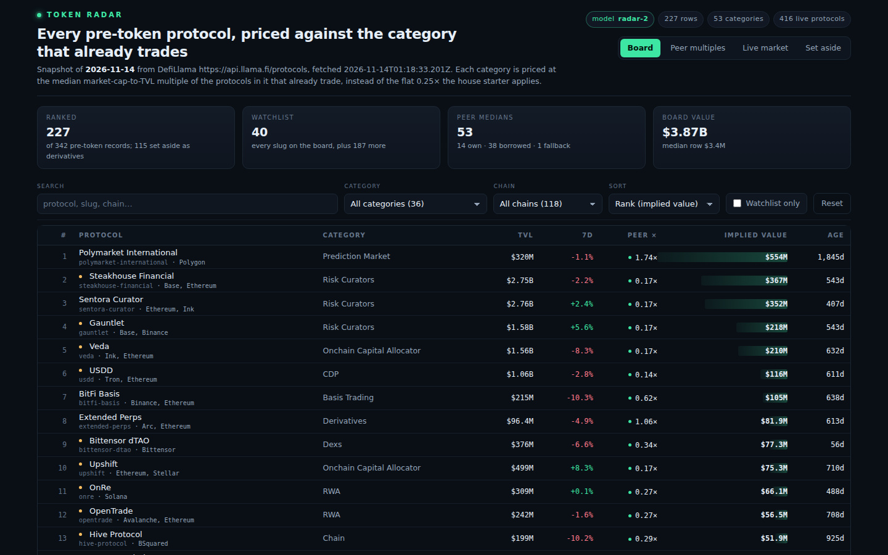
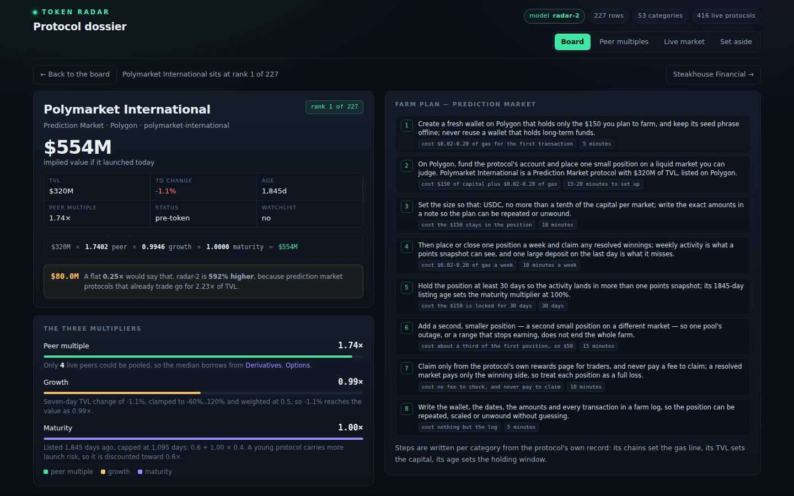
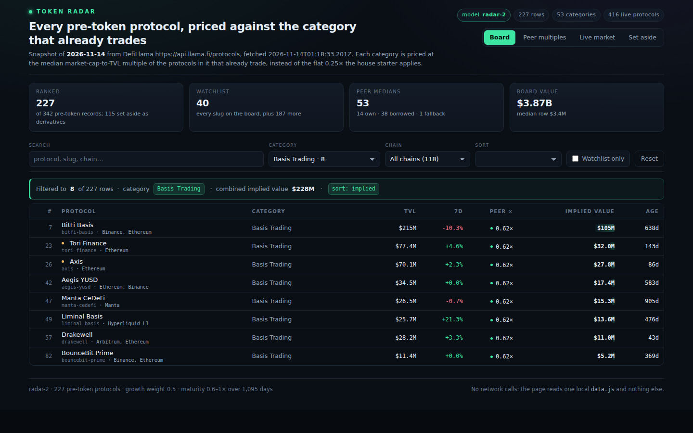

# Token Launch Radar


An entry for **make.fun `token-radar-01`**. The program reads the sealed DefiLlama
snapshot, asks what a protocol's token *would* be worth if its record stayed exactly
as it is, and hands back a board a reader can act on: every pre-token protocol ranked
by implied value, a detail view for each one, a filter, and the steps to farm it.

It does not predict whether or when a token is issued. Every implied value on the
board is this entry's own claim, never one make.fun makes.

## The model: radar-2

A flat "protocols are worth 0.25x their TVL" multiple is easy to write and wrong in a
way that matters — it prices a liquid-staking protocol and a bridge identically. Radar-2
prices each protocol against **its own category's realised multiples**, then bends that
multiple by how the protocol is actually behaving.

```
implied = max(1, round(tvl_usd × base_multiple × growth_mult × maturity_mult))
```

| Term | Where it comes from |
| --- | --- |
| `base_multiple` | median `mcap_usd / tvl_usd` of the protocol's **own category** |
| `growth_mult` | `1 + clamp(change_7d, floor, cap)/100 × weight` — recent momentum, clamped so one bad week cannot dominate |
| `maturity_mult` | `floor + min(age_days, window)/window × range` — a protocol listed 1,845 days ago earns full maturity, a fresh one does not |

**Peer discipline.** A category needs at least 3 peers with a live token before its
median is trusted. Below that, the multiple is **borrowed from the nearest category
family** rather than invented, and only when nothing sane exists does it fall back to
`0.2x` — recorded per row as `model.peer_source`, so a reader can see exactly how much
each number is worth.

The rubric forbids hardcoded name lists, so nothing here is a lookup table of protocols
to prices. Every number is derived from `tvl_usd`, `change_7d`, `listed_at` and
`mcap_usd` in the snapshot.

### What the run actually produced

| Metric | Value |
| --- | --- |
| Protocols in snapshot | 758 |
| Rows on the board | **227** (≥100 required) |
| Beyond the 40-token watchlist | 187 |
| Live-token protocols shown apart | 40 |
| Categories priced | 53 |
| Own-category median | 14 |
| Borrowed from category family | 38 |
| Fallback `0.2x` | 1 (contributes no rankable row) |
| Rows priced on a fallback | **0** |

## The dashboard

`dashboard/` is a static, dependency-free page — no framework, no network calls, so it
opens from disk exactly as it renders in the screenshots. It is driven by query params
so every view is deterministic and linkable:

| View | URL |
| --- | --- |
| Board | `?view=board` |
| Detail | `?view=detail&slug=<slug>` |
| Filtered | `?view=board&cat=Lending&sort=implied` |





Each row carries eight farm steps — wallet hygiene first, then sizing, cadence, holding
period, redundancy, claim safety and a written log — and every step states its **cost**
and its **time**, because a plan without those is not a plan.

## Run it

```bash
mkdir -p out
MAKEFUN_OUTPUT_DIR=out node main.ts --input <path>/snapshot.json
```

Under the grader the paths are absolute and no flags are needed: it reads
`/input/snapshot.json` and writes `/output/{board.json,data.js,dashboard/,screenshots/,dossier.json}`.

## Layout

```
main.ts                 the entry program: read, score, gate-check, write
lib/model.ts            radar-2: parseSnapshot, buildRadar, dataScript, boardIssue
dashboard/              index.html, app.css, app.js — the reader's view
screenshots/            board, detail, filtered (1440x900)
vendor/makefun-board.ts buildDossier, unchanged from the starter
out/                    build output (regenerated, not committed)
```

`main.ts` refuses to write a board its own gate would reject: `boardIssue` runs before
anything is written, and the dossier is written last because the scorer rebuilds it from
the output and compares bytes.

## License

MIT — see [LICENSE](LICENSE).
